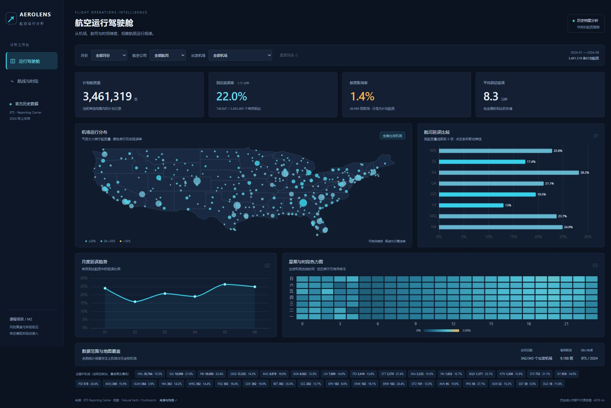
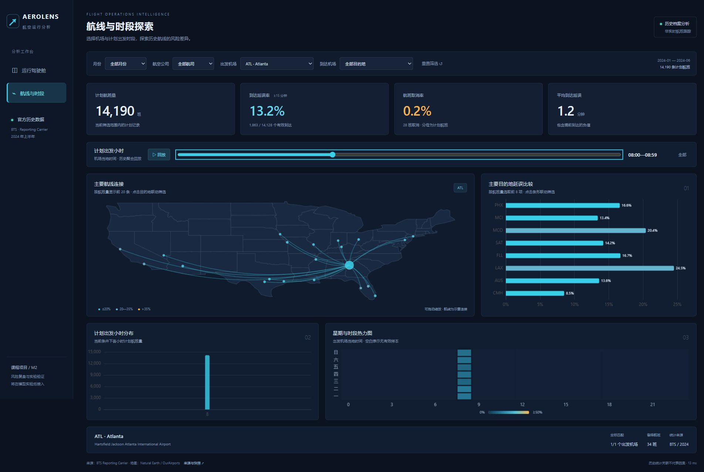
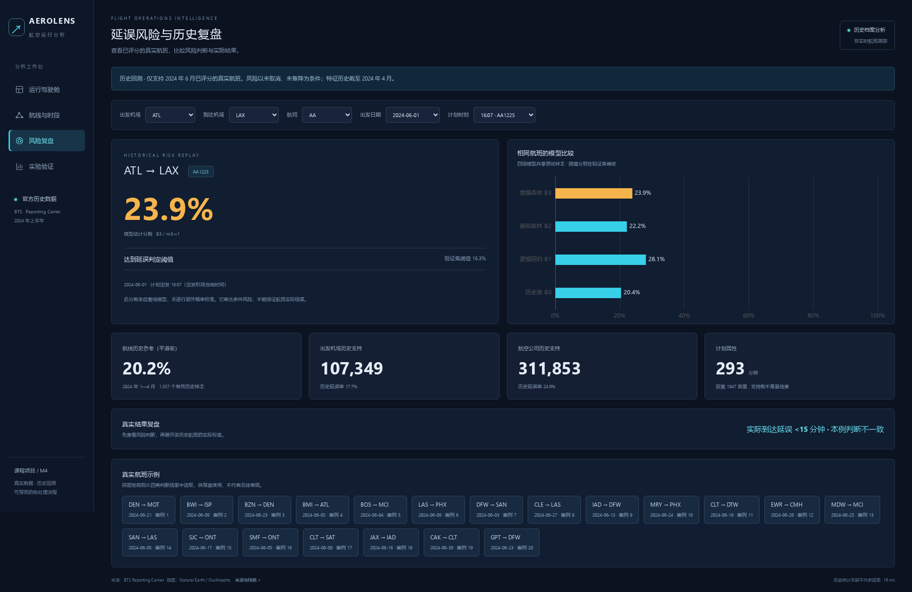

# 航空航班延误分析与风险预测系统

大数据分析技术与应用课程项目报告

数据范围：美国 BTS Reporting Carrier 2024 年 1 至 6 月

技术路线：HDFS、Spark、FastAPI、Vue 与 ECharts

组名：____________________
姓名与学号：____________________
班级：____________________
实际分工：见文末成员贡献页

摘要

本项目完成官方航班数据采集、分布式存储与处理、机器学习评估和网页展示。半年共处理3,461,319条计划航班，使用统一时间切分评估四组模型，并对同一份数据进行CSV与Parquet查询比较。B3在601,272条六月测试记录上的PR-AUC为0.376881，比B2高0.007634，F1基本持平；工程实验中Parquet查询中位数较低。系统提供四个真实数据页面，结果用于历史回测。部署采用单机伪分布式环境，不宣称多物理机集群或实时业务能力。

# 一 项目需求与研究范围

航班运行信息既具有机场与航线维度，也具有明显的时间维度。项目通过可重复的数据处理链回答三个问题：不同机场、航司和时段的延误情况如何；历史延误率和样本支持数能否改善计划特征模型；在相同查询及资源下，列式存储能否降低查询耗时。

课程要求覆盖数据采集、分布式存储与处理、智能分析、网页可视化及改进验证。项目采用HDFS保存原始数据与中间结果，Spark执行清洗、聚合、特征构造和模型批量评分，以FastAPI和Vue呈现已发布结果。教师评分包含选题设计20%、演示30%、报告25%、代码25%，交付材料包括PPT、报告、代码和演示视频。

正式数据限定为美国BTS Reporting Carrier On-Time Performance的2024年1至6月。项目不混用Marketing Carrier口径，也不将美国运行规律推广到中国。取消和备降单独统计，风险建模只研究未取消、未备降且具有有效到达标签的航班。

模型输入仅包含计划信息及严格回看的历史统计。网页检索六月已经评分的真实航班，不接受任意未来航班输入。系统未接入实时航空、天气或在线推理服务。六月回测冻结使用一至四月历史，不复原当年BTS文件实际公开时间。

设计的主要改进是将平滑历史机场、航司、航线统计及支持数加入基础随机森林，并在相同候选集合下比较。该做法作为课程中的方法改进进行验证，不宣称提出了新的机器学习算法。

# 二 数据来源与质量控制

采集脚本从BTS官方PREZIP目录下载月度ZIP，校验CRC并保存来源URL、UTC获取时间、文件大小、SHA256、表头和实际行数。原始数据不进入Git仓库，其他使用者通过下载脚本重建，避免将大文件和不必要的数据副本提交到代码仓库。

| 数据类别 | 半年记录数 | 解释 |
| --- | --- | --- |
| 计划航班 | 3,461,319 | 全部范围 |
| 有效标签 | 3,403,465 | 到达状态可判定 |
| 取消 | 48,666 | 单列统计 |
| 备降 | 9,188 | 单列统计 |
| 延误至少15分钟 | 748,647 | 有效标签正例 |

延误率采用有效标签中的延误航班数除以有效标签数，取消率使用计划航班数作为分母。到达延误平均值保留提前到达的负值。跨月份或跨机场聚合时先加总分子、分母，再计算比例，避免平均各组延误率造成权重错误。

清洗区分完全重复记录和业务键冲突。业务键包含日期、航司、航班号、起降机场和计划起飞时刻，不能只按航班号去重。时刻按机场本地时间解析，处理2400边界并拒绝非法分钟。关键字段异常进入隔离层并记录原因，不能静默截断或补造标签。

六个月均通过HDFS与Spark Standalone处理，并将月度计数、延误计数及到达延误分钟总和与独立CSV程序核对。机场底图来自Natural Earth，坐标采用OurAirports快照，来源与许可保存在地图sources.json中。未匹配坐标的机场仍保留统计。

# 三 系统架构与实现

数据链为Python采集、HDFS raw CSV、Spark清洗、silver Parquet、Spark聚合与MLlib建模、SQLite及实验JSON、FastAPI、Vue与ECharts。查询服务读取已经发布的产物，网页请求不会启动Spark作业，使演示与离线计算分离。

| 模块 | 职责 |
| --- | --- |
| ingestion | 官方文件下载、校验及地图素材快照 |
| spark_jobs | 清洗、聚合、时序历史特征、训练评分及格式实验 |
| backend | 只读统计接口、评分检索与实验结果接口 |
| frontend | 四页面联动、图表、加载和错误状态 |
| scripts / tests | 复现、独立数量核对、泄漏与API检查 |

处理环境为Windows11上的WSL2 Ubuntu22.04，使用独立Python3.10虚拟环境、JRE11、Hadoop3.3.6和Spark3.5.8。HDFS运行NameNode与DataNode，Spark运行Master与Worker，均为同机进程。Spark local仅用于早期调试，正式数据处理保存了Standalone application_id和hdfs://输入输出证据。

代码、数据和运行环境放在D盘，项目不修改既有科研环境。HDFS与Spark使用项目端口，服务仅面向本机演示。数据计算结束后停止集群，网页服务仍可使用本地数据库展示已完成结果。

统计数据库使用只读快照与按文件版本的缓存，评分库按真实航班身份查询。参数采用SQL绑定，动态维度采用白名单。无数据时返回明确错误或空态，不生成示例数值冒充处理结果。

# 四 运行分析与航线探索

运行驾驶舱展示实际KPI、机场地图、月份趋势、航司排名和星期与小时热力图。月份、航司和机场筛选会同时改变多个图表，并显示当前样本范围和口径。地图不依赖在线CDN，适合课程离线演示。

图1 真实半年运行驾驶舱

航线页面围绕出发机场展开，显示主要目的地、前20条航线、小时分布与详情。地图点击与小时刷选使用相同API筛选条件。机场之间的线段为示意连接，不代表实际飞行轨迹。无匹配航班时显示空列表和空比例。

图2 航线与时段探索

# 五 时间切分与模型设计

一月作为历史预热，二至四月正式训练，五月验证，六月测试。训练样本为1,677,597条，验证599,226条，测试601,272条。二月历史仅来自一月，三月来自一至二月，四月来自一至三月。五月和六月均冻结使用一至四月历史。编码器、数值变换只在训练样本拟合。

| 模型 | 方法 | 特征 |
| --- | --- | --- |
| B0 | 历史分层回退 | 平滑历史率与低支持回退 |
| B1 | LogisticRegression | 基础计划特征 |
| B2 | RandomForestClassifier | 相同基础计划特征 |
| B3 | RandomForestClassifier | 基础特征及历史率、支持数和缺失标记 |

基础特征包含星期、计划时刻、航司、起降机场、距离和计划耗时，不将完整日期编码为类别。实际起降时间、延误分钟、取消备降状态和延误原因不进入特征。取消备降筛选是条件样本定义，不代表取消风险预测。历史率采用强度100的平滑，降低低支持组合的极端估计。

随机种子42。B1测试两个正则候选，B2与B3各测试32棵树、深度5或7两个候选，使用相同预算和每节点4个候选特征。验证PR-AUC决定参数，验证集最大F1决定阈值，阈值随后冻结。正式拟合共六次，没有根据六月结果追加搜索。小规模试跑仅检查链路，不用于选优。

B1采用one-hot，随机森林采用名义类别索引，因此B1与B2的差异还包含特征表示差异。分层历史基线不需要正式训练。完整候选、资源、耗时、配置SHA256和运行标识保存在results/m3/metrics.json及实验协议中。

# 六 模型实验结果与解释

| 模型 | PR-AUC | ROC-AUC | F1 | Brier |
| --- | --- | --- | --- | --- |
| B0 | 0.304982 | 0.578791 | 0.405003 | 0.188619 |
| B1 | 0.369400 | 0.662958 | 0.457357 | 0.182020 |
| B2 | 0.369247 | 0.662270 | 0.457520 | 0.186436 |
| B3 | 0.376881 | 0.670690 | 0.457416 | 0.183234 |

主指标PR-AUC采用sklearn完整precision-recall曲线的梯形积分，Average Precision另行保存，不混为同一指标。Brier越低越好。六月正例149,945条，比例约24.94%。四模型评分从SQLite独立重算，全部指标最大差异为0。

B3相对B2的测试PR-AUC增加0.007634，ROC-AUC也较高，F1基本持平。B1的Brier为0.182020，比B3的0.183234更低。B3的精确率0.321309、召回率0.793578，说明验证F1所选阈值下识别较多正例，同时存在较多误报。不能将较高排序指标等同于全面业务收益。

| 配对候选 | B2验证PR-AUC | B3验证PR-AUC | 差值 |
| --- | --- | --- | --- |
| 深度5 | 0.397321 | 0.399828 | +0.002508 |
| 深度7 | 0.395870 | 0.405134 | +0.009264 |

相同参数的验证比较支持历史特征改善排序能力。但测试主表B2选中深度5、B3选中深度7，不能把测试差值全部归因于历史特征，也不能凭Gini重要性证明某项历史统计的因果机制。历史关联、性能变化和方法创新分别表述。

系统保存10个固定可靠性分箱及样本数，并按机场、起飞小时和历史支持数分析错误。模型分数尚未独立校准，不应把显示的23.9%理解成已经验证准确的实际概率。

# 七 风险复盘与实验验证

风险复盘只查询六月已经评分的真实航班，依次选择机场、航司、日期和计划时刻。页面显示推荐B3分数、验证阈值、四模型比较及历史支持数。实际标签默认隐藏，主动展开后才显示结果一致与否，更换航班后重新隐藏。

图3 六月真实航班复盘

固定20个确定性案例覆盖TP、FP、FN、TN，每类5个。它们用于解释判断过程，不代表总体性能。接口在默认响应中移除标签，示例列表也不提前提供实际类别。不存在的真实组合返回空态，避免构造无法核验的航班。

实验页面直接读取已通过独立核验的结果，展示完整测试表、PR曲线、可靠性图、混淆矩阵、配对验证及分组错误。切换模型时图表同步更新，工程区域记录每轮时间、资源与缓存限制。实验未完成时接口明确返回不可用状态。

# 八 存储格式工程实验

从相同清洗数据投影month、Reporting_Airline、Origin、eligible、delayed五列，全部3,461,319行分别写为CSV与Parquet。两者均为4个分区，CSV显式指定schema。查询按月份、航司和出发机场分组，计算计划数、有效标签数和延误数，固定相同资源。

| 格式 | 第1轮秒 | 第2轮秒 | 第3轮秒 | 中位数秒 |
| --- | --- | --- | --- | --- |
| CSV | 2.529077 | 1.750420 | 1.775511 | 1.775511 |
| Parquet | 0.960921 | 0.690064 | 0.705537 | 0.705537 |

实际Standalone作业为app-20261116091019-0000，2核、executor 1GB、driver 1GB。三轮交替顺序执行，每次清除Spark缓存，不计格式转换时间。查询均得到9,327组，规范排序结果的SHA256完全一致。

CSV文件合计65,765,253字节，Parquet合计1,326,202字节，各5个文件。Parquet本次中位耗时约为CSV的39.7%。这只是该数据投影、该机器和该缓存条件下的观察，不能推广为通用加速倍数。

实验未清除操作系统和HDFS缓存，不能称为冷读。文件存储大小不等于实际扫描字节数，也不代表原始全字段数据的压缩比例。完整输入到清洗产物的ETL耗时与格式查询耗时属于不同测量，不将两者混为纯存储格式收益。

对照通过相同行数、相同字段、相同聚合结果和一致资源，限制了影响比较的主要变量。单机WSL环境的调度与缓存波动仍然存在，因此保留每轮记录并报告中位数，而不是只挑最快的一轮。

# 九 验证复现与问题处理

数量核对程序独立读取官方CSV，验证各月计划、有效、延误、取消、备降及到达延误分钟总和。模型验证程序独立读取SQLite分数重算指标。测试覆盖时刻边界、时间历史快照、清洗样本定义、API参数和实际标签隐藏。

M4普通测试7项通过，2项依赖JVM的测试在普通模式跳过；JVM边界测试已在M3实际通过。前端生产构建通过。真实Playwright浏览器在1366×768和1920×1080检查日期切换、标签隐藏与展开、模型图表和误差分组，最终控制台0错误0警告。停止后重新启动API，健康、页面、统计、模型及筛选接口均返回200。

实现中解决了WSL命令退出导致HDFS收到SIGHUP、PySpark包缺少Master与Worker脚本、挂载盘随机读取影响查询等问题。分别采用独立会话启动、spark-class启动守护进程、只读内存快照及版本缓存解决。原始运行日志保存在本地产物目录，不将临时日志提交为源代码。

复现顺序：创建独立依赖环境，下载官方六个月ZIP，启动HDFS和Standalone，运行run_all_months.sh，依次运行run_ml.sh的prepare、pilot、formal、export，再执行verify_ml.py和report_m3.py。工程对比运行run_benchmark.sh。前端npm ci后build，最后启动uvicorn。完整命令和依赖锁见README。

使用已发布数据库演示时只需启动后端，不需要在线重新训练。其他使用者克隆代码后必须按README重建数据库，GitHub仓库不包含数百万条原始文件、HDFS块或大模型。仓库发布与课程正式提交是独立事项，上传GitHub不代表已经向教师交作业。

# 十 总结与成员贡献

项目完成了半年官方航班数据的可复核处理链、四组固定预算模型评估、四页面交互以及存储格式对照。结果支持在本次回测中使用历史特征改善排序能力，也表明模型仍有明显误报、校准不足和样本范围限制。工程结果支持Parquet在本次相同聚合查询中的效率优势，缓存与单机环境限制了结论外推。

后续改进可研究独立校准、时间外验证和更充分的外部条件，但这些属于未来工作，本次未实施，也不将未完成部分写成系统能力。

成员贡献须按实际劳动填写

| 姓名 学号 班级 | 实际承担模块与工作 | 验证和讲解内容 |
| --- | --- | --- |
| ________________ | ________________ | ________________ |
| ________________ | ________________ | ________________ |

按实际个人或小组情况增删行。组员应能够解释自己承担的实现与验证，PPT、报告和正式提交中的分工保持一致。工具辅助生成的内容仍需实际成员理解、检查并如实披露。

参考来源与产物索引

BTS官方数据目录：https://www.transtats.bts.gov/PREZIP/

BTS字段定义：https://www.transtats.bts.gov/Fields.asp?gnoyr_VQ=FGJ

项目最终方案与数据契约：docs/final_plan.md、data_contract.md

模型协议与真实结果：docs/m3_protocol.md、results/m3/metrics.json

独立评分验证：results/m3/verification.json

工程原始结果：results/engineering/benchmark.json

地图来源与许可：frontend/public/maps/sources.json
